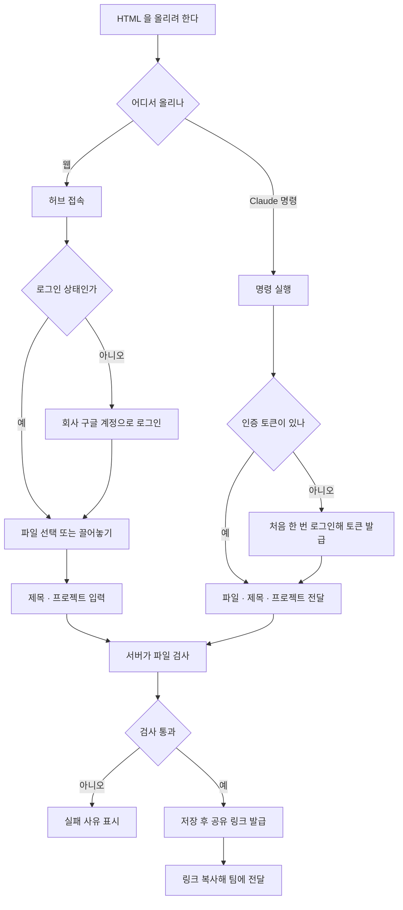
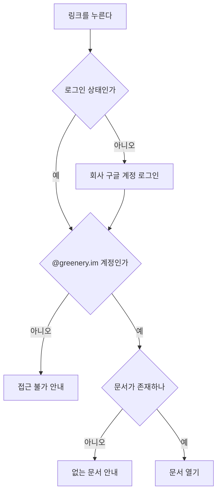
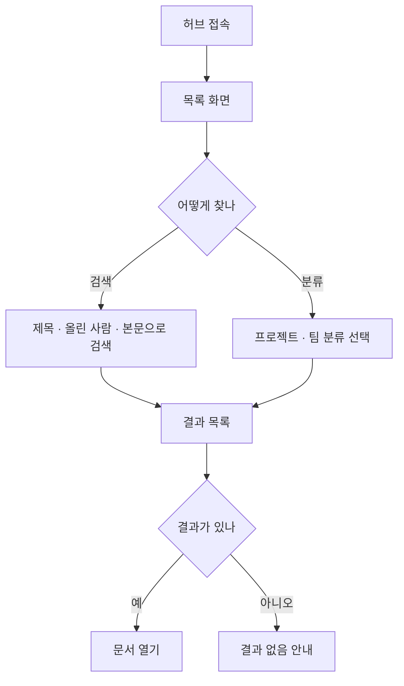

# 유저 플로우

> 단계: 해법 설계 / 상태: 초안 / 작성일: 2026-11-11
>
> 유저 플로우는 화면 사이의 이동을 그린다. 화면 안의 배치는 와이어프레임에서 다룬다. 이 문서의 흐름은 **설계 가설**이고, 사용자 검증은 아직 없다.

## 범위

JTBD 중 J1(올리기), J3(링크로 열기), J4(찾기)만 다룬다. J2(같은 링크로 내용 교체)와 J5(댓글)는 MVP 우선순위를 정한 뒤 추가한다.

## 플로우 1: 올리기 (J1)

올리는 방법은 둘이다. 웹에서 올리거나 Claude 명령으로 올린다. 두 경로는 로그인 확인 방식만 다르고 서버에서 만나는 지점은 같다.

## 플로우 2: 링크로 열기 (J3)

받은 링크를 누르면 읽는 데까지 클릭을 늘리지 않는 것이 목표다. 로그인 상태가 이미 있으면 바로 열린다.

## 플로우 3: 찾기 (J4)

## 이 플로우가 정해야 할 것

- **검색 대상은 제목, 올린 사람, 본문이다** (정책서 F1). 본문 검색은 HTML 에서 보이는 글자만 뽑아 색인해야 한다.
- **파일 검사 규칙**은 정책서 U3~U4 에 정했다 (10MB, `.html` 한 파일, 가정).
- **삭제와 수정**은 올린 사람과 관리자(IT 팀)만 하며, 이 플로우에는 그리지 않았다. 새 버전 교체 플로우(J2)는 아직 그리지 않았다.
- **회사 밖 사람에게 링크를 보냈을 때**는 플로우 2에서 "접근 불가"로 끝난다. 외부 공유는 하지 않기로 했다 (정책서 A2).

## 다음 단계로 넘기는 것

- 정책서: 삭제·수정 권한, 파일 크기 한도, 같은 제목 처리, 전 직원 열람의 부담
- 보안 설계: 업로드된 HTML 안의 JS 가 실행되므로, 문서를 여는 도메인과 로그인 도메인을 분리해야 한다 (설계 단계에서 다룬다)
